# MIRAGE
### Adaptive Precision for Software-Based Color Image Enhancement

**A C++20 research project investigating sensitivity-guided, tile-based adaptive numerical precision, AVX2/FMA SIMD optimization, and image-quality versus computational-cost trade-offs.**

<p align="center">
  <a href="docs/images/mirage_studio_screenshot.png">
    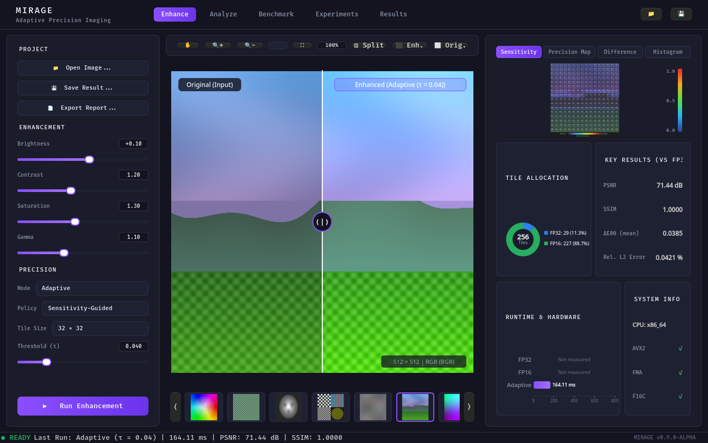
  </a>
</p>

<p align="center">
  <a href="https://github.com/ankursaini200/Mirage">
    
  </a>
  <a href="https://cmake.org/">
    
  </a>
  <a href="https://opencv.org/">
    
  </a>
  <a href="https://github.com/ankursaini200/Mirage/actions/workflows/ci.yml">
    
  </a>
  <a href="LICENSE">
    
  </a>
</p>

<p align="center">
  <a href="#2-how-mirage-works">Pipeline</a> •
  <a href="#4-mirage-dark-creative-studio">Mirage Studio</a> •
  <a href="#5-research-and-experimental-findings">Research &amp; Graphs</a> •
  <a href="#9-building-from-source">Build</a> •
  <a href="#10-usage">Usage</a> •
  <a href="#12-research-dataset">Dataset</a>
</p>

> **Research Disclaimer**: **Mirage is an experimental research project.** Performance, bandwidth, and quality trade-offs reported in this repository reflect controlled empirical measurements under software-emulated FP16 and AVX2 scalar/vector execution on x86_64 hardware, rather than universal speedups across all platforms.

---

## 1. Introduction

Mirage is an open-source, research-oriented image-processing engine developed in C++20.

It investigates whether assigning different numerical precisions to different spatial regions of an image can improve the trade-off between image quality, memory traffic, and computational cost.

Conventional image-processing pipelines generally apply a uniform numerical precision across the entire image. Mirage explores an alternative approach:

1. Divide an image into spatial tiles.
2. Analyze the spatial and chromatic characteristics of each tile.
3. Calculate a normalized sensitivity score.
4. Assign FP32 or FP16 precision according to the selected policy.
5. Process each tile and evaluate the resulting image quality and execution cost.

The central research question is:

> **Can sensitivity-guided adaptive precision produce a better image-quality versus computational-cost trade-off than uniform precision and random tile allocation?**

Mirage combines numerical analysis, image processing, CPU architecture, SIMD optimization, hardware performance counter measurements, and reproducible research experiments.

---

## 2. How Mirage Works

### Adaptive Precision Pipeline

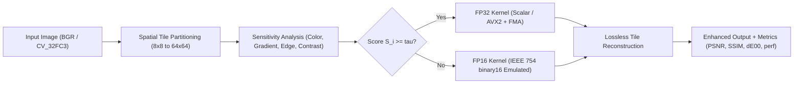

Mirage divides an image into non-overlapping spatial regions called tiles. Each tile is analyzed using four characteristics:

- Color variation ($C$)
- Gradient magnitude ($G$)
- Edge density ($E$)
- Local contrast ($L$)

These characteristics contribute to a weighted normalized sensitivity score:

$$
S_i \in [0, 1]
$$

### Precision Assignment Policy

Given a sensitivity score $S_i$ and threshold $\tau$:

$$
P_i =
\begin{cases}
\text{FP32} & \text{if } S_i \ge \tau \\
\text{FP16} & \text{if } S_i < \tau
\end{cases}
$$

The default threshold is:

$$
\tau = 0.04
$$

The threshold controls how many tiles receive higher precision:

- **Lower threshold**: More FP32 tiles (higher numerical fidelity).
- **Higher threshold**: More FP16 tiles (lower precision footprint).

The sensitivity score is a heuristic, not a proven model of human visual perception. Its effectiveness is evaluated experimentally against numerical errors and perceptual color differences relative to the FP32 scalar reference.

---

## 3. Core Features

### C++20 Image Processing Engine

- Validated image loading supporting `JPG`, `JPEG`, `PNG`, and `BMP` with corrupted/empty file rejection.
- BGR, RGB, and scientific floating-point CIELAB color space conversions.
- Spatial tile partitioning with non-divisible edge-boundary clamping and zero-copy OpenCV ROI views.
- Lossless tile reconstruction.
- Brightness, contrast, Rec. 709 luminance-preserving saturation, and power-law gamma enhancement.

### Multiple Precision Modes

| Mode | Description |
| :--- | :--- |
| `fp32` | Uniform single-precision reference pipeline |
| `fp16` | Software-emulated IEEE 754 `binary16` arithmetic (`mirage::core::Half`) |
| `mixed` | Configurable per-operation precision assignment (`MixedPrecisionPolicy`) |
| `adaptive` | Sensitivity-guided tile-based FP32 / FP16 dispatch |

The software `Half` implementation supports:

- Round-to-nearest, ties-to-even (RNTE).
- Normal and subnormal values.
- Signed zero, infinity, and NaN propagation.
- Overflow and underflow handling.

> [!NOTE]
> **FP16 Emulation Notice**: FP16 arithmetic in Mirage is currently **software-emulated** on x86_64 integer/bit paths and does not represent native hardware FP16 throughput.

### SIMD Optimization

Mirage provides a portable scalar reference backend alongside an isolated AVX2/FMA backend (`src/simd/avx2_kernels.cpp` compiled cleanly with `-mavx2 -mfma`).

Implemented AVX2 operations:

- Brightness adjustment (`adjust_brightness_avx2`)
- Contrast adjustment (`adjust_contrast_avx2`)
- Fused brightness and contrast (`adjust_brightness_contrast_avx2`)
- Rec. 709 saturation adjustment (`adjust_saturation_avx2`)

Power-law gamma correction remains scalar (`std::pow`) to preserve strict FP32 reference numerics. Runtime dispatch checks CPUID, `OSXSAVE`, and `XCR0` for both **AVX2** and **FMA** before selecting vectorized execution:

```bash
--backend auto
--backend scalar
--backend avx2
```

### Sensitivity Analysis

Supported nominal tile dimensions: `8 × 8`, `16 × 16`, `32 × 32`, and `64 × 64`.

- Configurable feature weights (`color`, `gradient`, `edge`, `contrast`).
- Per-tile sensitivity scoring (`[0.0, 1.0]`).
- `COLORMAP_TURBO` heatmap visualization and spatial FP32/FP16 precision maps.
- Per-tile CSV telemetry export.

### Image Quality Metrics

Evaluated against the uniform FP32 scalar enhanced reference:

| Metric | Purpose |
| :--- | :--- |
| **MAE** | Mean Absolute Error ($L_1$) |
| **RMSE** | Root Mean Square Error ($L_2$) |
| **Max Abs Error** | Maximum per-channel numerical deviation |
| **PSNR** | Peak Signal-to-Noise Ratio (dB) |
| **SSIM** | Structural Similarity Index (channel-split $11 \times 11$ Gaussian window) |
| **$\Delta E_{00}$** | CIEDE2000 perceptual color difference (Sharma et al., 2005) |
| **Relative $L_2$** | Normalized relative error |

### Hardware Performance Analysis

Mirage includes direct Linux hardware performance counter instrumentation via `perf_event_open()` (`benchmarks/perf_sampler.hpp`):

- CPU cycles, instructions retired, and IPC.
- Last-level/cache references and misses.
- Branch instructions and branch mispredictions.
- Roofline arithmetic intensity modeling ($\mathcal{I} = \text{FLOPs}/\text{Byte}$) and memory traffic analysis.

---

## 4. Mirage 

Mirage includes a desktop research application developed with **PySide6** (`scripts/mirage_studio.py`), decoupled from the C++ engine via asynchronous `QProcess` calls and a structured `--json` CLI contract.

### Application Workspaces

| Tab | Functionality |
| :--- | :--- |
| **Enhance** | Image loading, +/- numeric enhancement controls, precision policy configuration, draggable split before/after viewer, zoom/pan, filmstrip carousel, live sensitivity heatmap, tile allocation donut chart, measured runtime chart, and CPU ISA telemetry |
| **Analyze** | Per-tile sensitivity breakdown table (`Tile ID`, position, partial-edge flag, FP32/FP16 assignment, and sensitivity score) |
| **Benchmark** | Live hardware microbenchmark explorer backed by recorded CSV measurements (`benchmarks/results/benchmark_results.csv`) |
| **Experiments** | Categorized research workspace (*Adaptive Precision*, *Performance Analysis*, *Pareto Analysis*, *Tile Architecture*), publication plots, filterable CSV data explorer, and isolated C++ experiment runner |
| **Results** | Latest enhancement execution summary, split comparison, quality metrics vs. FP32 reference, FP32/FP16 distribution donut, sensitivity heatmap, and spatial precision map |

### Interface Views

<table>
  <tr>
    <td width="50%" align="center">
      <a href="docs/images/results_tab_corrected.png">
        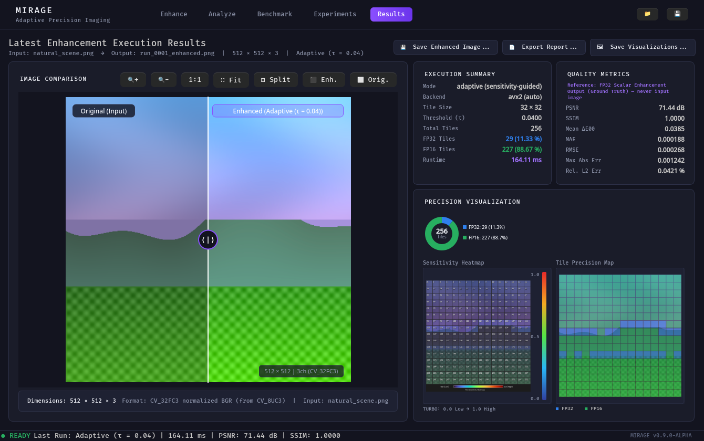
      </a>
      <br>
      <em><b>Results</b> — Live Quality Metrics, Donut Allocation &amp; Precision Maps</em>
    </td>
    <td width="50%" align="center">
      <a href="docs/images/experiments_cat_adaptive_precision.png">
        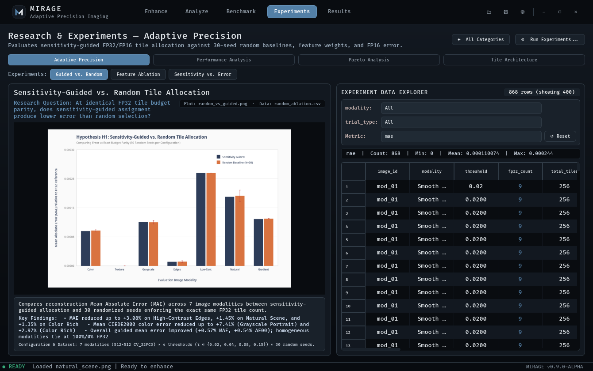
      </a>
      <br>
      <em><b>Experiments</b> — Research Categories, Plots &amp; CSV Explorer</em>
    </td>
  </tr>
  <tr>
    <td width="50%" align="center">
      <a href="docs/images/analyze_tab.png">
        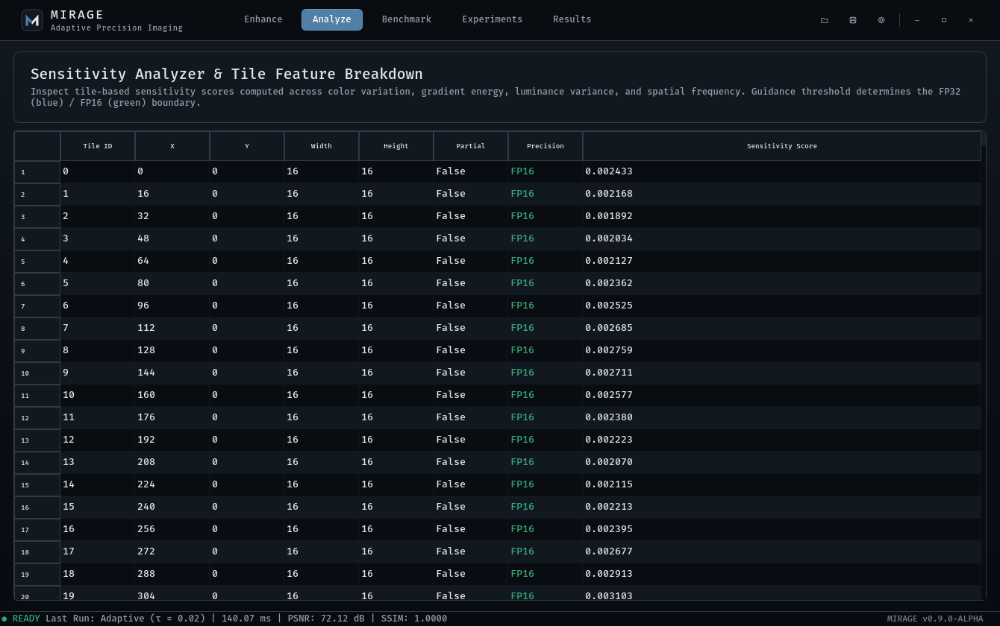
      </a>
      <br>
      <em><b>Analyze</b> — Per-Tile Sensitivity Scores &amp; Precision Assignment</em>
    </td>
    <td width="50%" align="center">
      <a href="docs/images/benchmark_tab.png">
        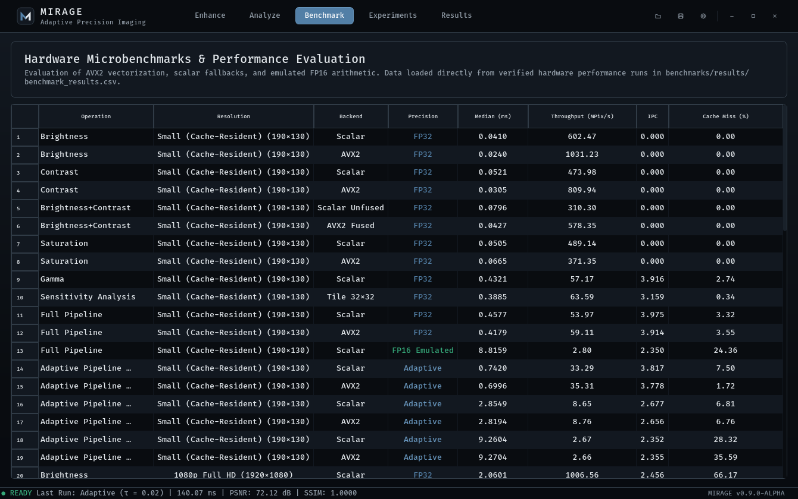
      </a>
      <br>
      <em><b>Benchmark</b> — Measured Kernel Latency, IPC &amp; Cache Miss Data</em>
    </td>
  </tr>
</table>

---

## 5. Research and Experimental Findings

All experimental protocols, statistical tests, and raw CSV records are preserved in [`benchmarks/experiments/`](benchmarks/experiments/), [`benchmarks/results/`](benchmarks/results/), [`docs/performance-analysis.md`](docs/performance-analysis.md), and [`docs/research-results.md`](docs/research-results.md).

### Adaptive Allocation vs. 30-Seed Random Baseline & Feature Ablation

The random baseline enforces **exact FP32 tile budget parity** ($K$ FP32 tiles out of $N$) across **30 independent `std::mt19937` seeds** per image and threshold configuration.

- On tested heterogeneous modalities, sensitivity-guided allocation reduced MAE by up to **+3.08%** (*High-Contrast Edges*) and **+1.45%** (*Natural Scene*), and reduced mean $\Delta E_{00}$ by up to **+7.41%** (*Grayscale Portrait*) and **+2.97%** (*Color Rich*).
- Across 1,792 evaluated tiles, **edge density ($E$)** showed the strongest positive linear correlation with FP16 numerical error ($r = +0.2332, p = 1.49 \times 10^{-23}$), while `color_only` suffered a **4.41 dB** PSNR drop from severe FP32 under-allocation.

<table>
  <tr>
    <td width="50%" align="center">
      <a href="benchmarks/plots/random_vs_guided.png">
        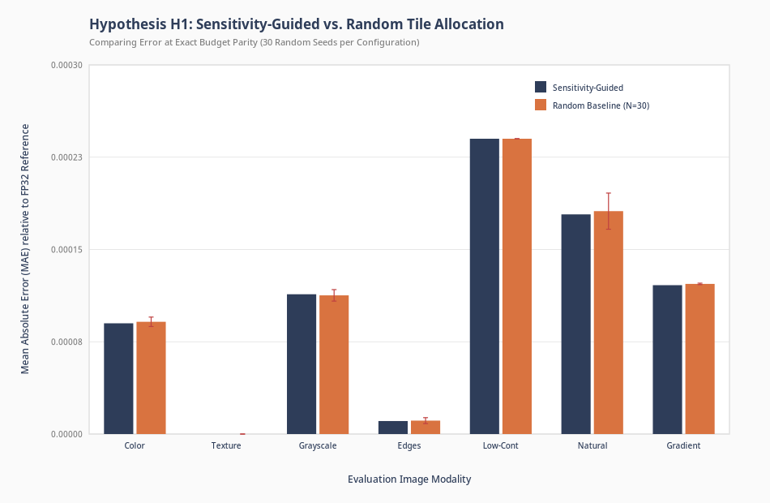
      </a>
      <br>
      <em>Sensitivity-Guided vs. 30-Seed Random Allocation at Budget Parity</em>
    </td>
    <td width="50%" align="center">
      <a href="benchmarks/plots/feature_ablation.png">
        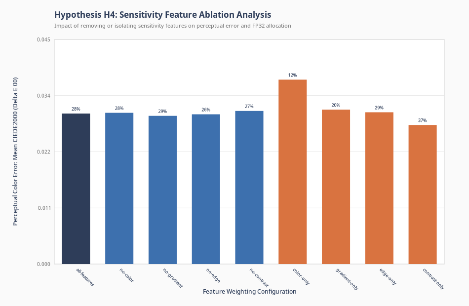
      </a>
      <br>
      <em>Leave-One-Out &amp; Single-Feature Ablation (CIEDE2000 &amp; FP32 %)</em>
    </td>
  </tr>
</table>

### SIMD Vectorization, Kernel Fusion & Hardware Roofline

Measured on an Intel Core i7-13650HX (Raptor Lake, DDR5-4800, Linux `perf_event_open()`):

| Operation | 1080p Scalar (ms) | 1080p AVX2 (ms) | 1080p Speedup | Roofline Regime |
| :--- | :---: | :---: | :---: | :--- |
| **Brightness** | 2.060 | 2.028 | **1.02×** | Memory-Bound (0.250 FLOP/B) |
| **Contrast** | 2.113 | 2.149 | **0.98×** | Memory-Bound (0.375 FLOP/B) |
| **Fused Brightness + Contrast** | 3.913 *(unfused)* | **2.072** | **1.89×** | Halves DRAM Traffic (0.625 FLOP/B) |
| **Saturation** | 2.890 | **2.128** | **1.36×** | Memory-Bound (0.708 FLOP/B) |
| **Full Pipeline** | 40.379 | **36.474** | **1.11×** | Capped by Scalar `std::pow` Gamma |

Vectorizing standalone memory-bound stages collapses IPC (e.g., Brightness IPC drops from `2.46` to `0.84` on DRAM stalls). Fusing Brightness + Contrast in YMM registers eliminates intermediate DRAM traffic and achieves **1.89× speedup on 1080p** (**1.93× on 4K UHD**).

<table>
  <tr>
    <td width="50%" align="center">
      <a href="benchmarks/plots/scalar_vs_avx2_speedup.png">
        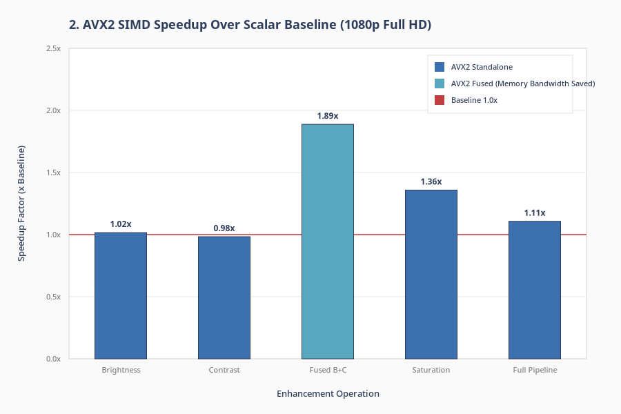
      </a>
      <br>
      <em>1080p AVX2 Speedup Over Scalar Baseline</em>
    </td>
    <td width="50%" align="center">
      <a href="benchmarks/plots/arithmetic_intensity_by_operation.png">
        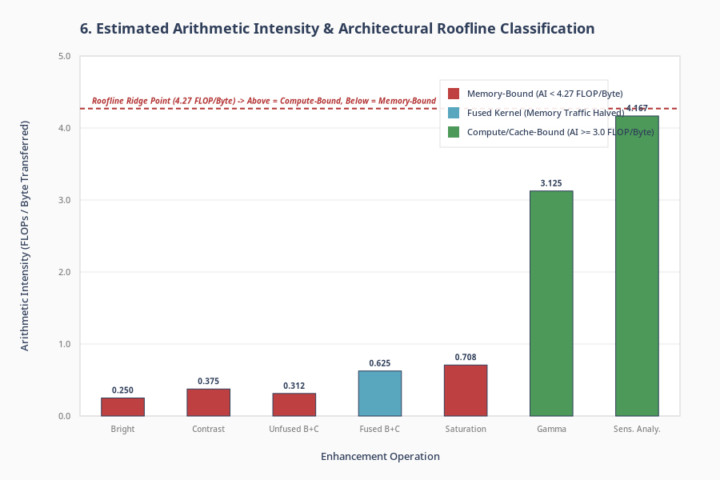
      </a>
      <br>
      <em>Arithmetic Intensity vs. 4.27 FLOP/Byte Machine Ridge Point</em>
    </td>
  </tr>
</table>

### Software FP16 Emulation Overhead (Key Negative Result)

On x86_64 CPUs lacking native vector FP16 arithmetic, IEEE 754 software `binary16` emulation introduces an **11.4× dynamic instruction overhead** (`6.58B` vs. `575M` instructions at 1080p) and a **17.2× cycle overhead** (`2.64B` vs. `153M` cycles, `699.07 ms` vs. `40.38 ms` scalar FP32). Lower numerical precision only accelerates execution when paired with **native hardware FP16/vector execution units**.

<table>
  <tr>
    <td width="50%" align="center">
      <a href="benchmarks/plots/ipc_by_configuration.png">
        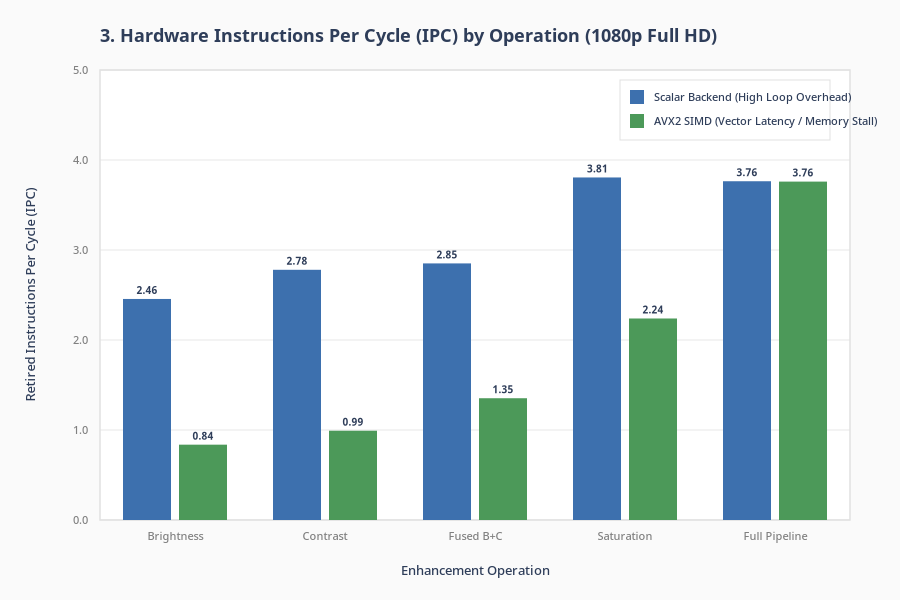
      </a>
      <br>
      <em>Measured Hardware IPC (Memory Stalls vs. Vectorized Kernels)</em>
    </td>
    <td width="50%" align="center">
      <a href="benchmarks/plots/adaptive_distribution_vs_runtime.png">
        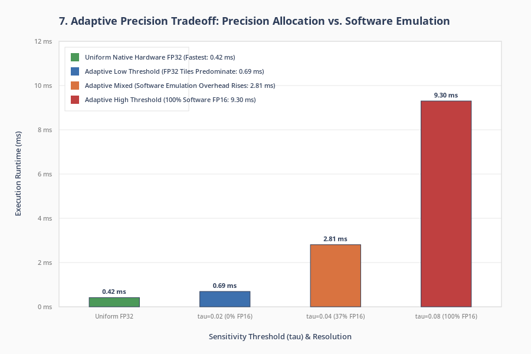
      </a>
      <br>
      <em>Precision Allocation vs. Software FP16 Emulation Latency</em>
    </td>
  </tr>
</table>

### Tile Granularity & Multi-Objective Pareto Frontiers

Experiments sweep nominal tile sizes from `8 × 8` (4,096 tiles at 512×512) to `64 × 64` (64 tiles) and thresholds $\tau \in [0.00, 1.00]$:

- `8 × 8` tiles incur a **+27.88%** mean pipeline overhead (`62.74 ms`) vs. `64 × 64` (`49.06 ms`), establishing **`32 × 32` to `64 × 64`** as the practical architectural sweet spot balancing spatial selectivity and dispatch overhead.
- With **27.6% FP32 allocation**, guided adaptive precision preserves **79.26 dB PSNR** and **$\Delta E_{00} = 0.03016$** (far below the human just-noticeable difference threshold of `1.0`).

<table>
  <tr>
    <td width="50%" align="center">
      <a href="benchmarks/plots/tile_size_comparison.png">
        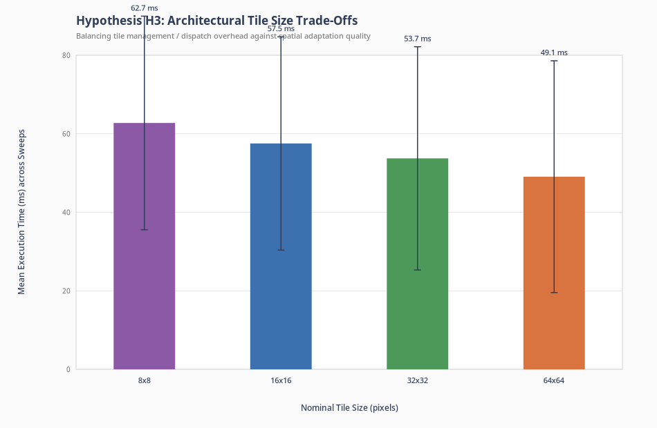
      </a>
      <br>
      <em>Architectural Tile Size Comparison (8x8 to 64x64)</em>
    </td>
    <td width="50%" align="center">
      <a href="benchmarks/plots/runtime_vs_resolution.png">
        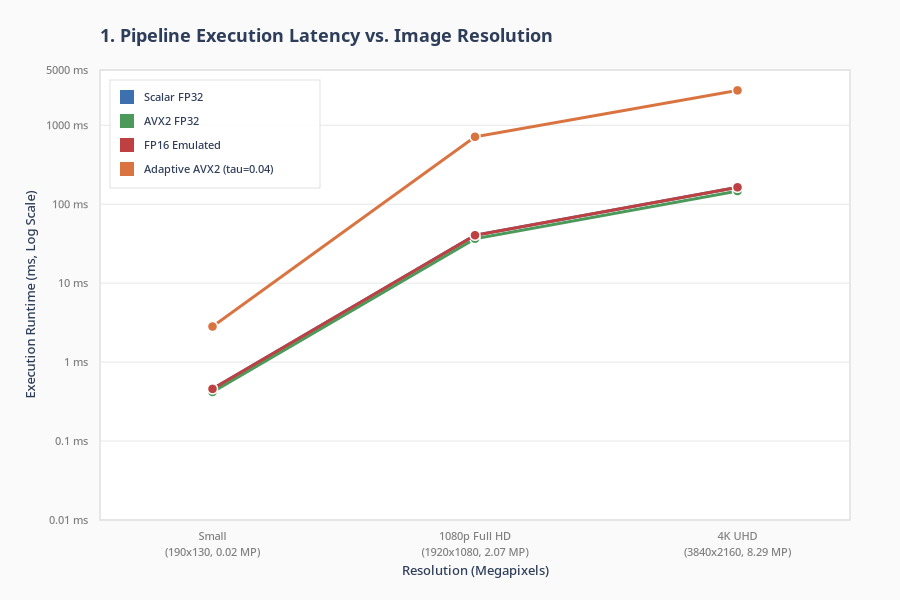
      </a>
      <br>
      <em>Execution Latency Scaling Across Cache-Resident, 1080p, and 4K</em>
    </td>
  </tr>
  <tr>
    <td width="50%" align="center">
      <a href="benchmarks/plots/pareto_error_runtime.png">
        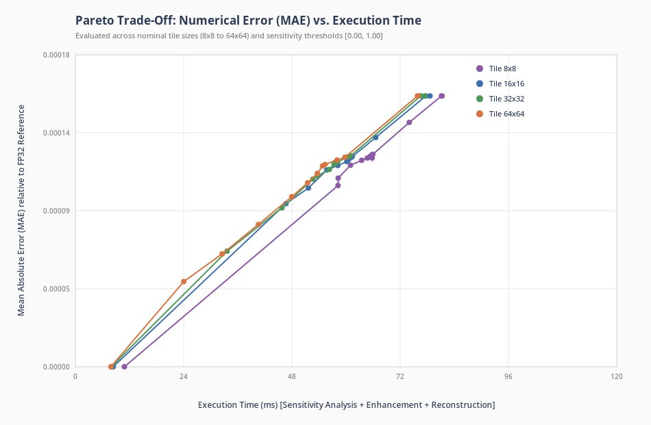
      </a>
      <br>
      <em>Pareto Frontier: Reconstruction MAE vs. Execution Time</em>
    </td>
    <td width="50%" align="center">
      <a href="benchmarks/plots/pareto_deltae_runtime.png">
        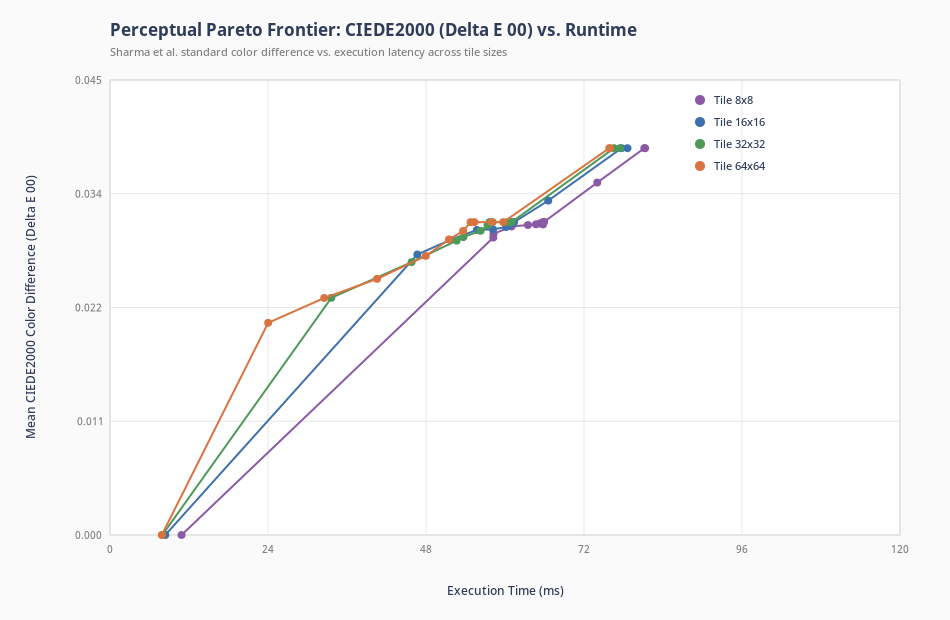
      </a>
      <br>
      <em>Perceptual Pareto Frontier: CIEDE2000 vs. Execution Time</em>
    </td>
  </tr>
</table>

---

## 6. Technology Stack

| Technology | Purpose |
| :--- | :--- |
| **C++20** | Core imaging engine, `Half` emulation, SIMD kernels, and experiment binaries |
| **CMake 3.20+** | Build system and presets (`default`, `debug`, `release`) |
| **OpenCV 4 / 5** | Image I/O (`core`, `imgproc`, `imgcodecs`) and matrix storage |
| **AVX2 / FMA** | Isolated 256-bit SIMD enhancement kernels (`-mavx2 -mfma`) |
| **Python 3** | Desktop Studio UI and offline statistical / plotting pipelines |
| **PySide6** | Mirage Dark Creative Studio GUI |
| **NumPy & pandas** | Experiment tabular data analysis |
| **Pycairo** | Publication-grade PNG research plotting |
| **GoogleTest & CTest** | Unit, CLI, and integration test suite |
| **Linux `perf_event_open`** | In-process hardware counter instrumentation |
| **GitHub Actions** | Continuous integration across GCC & Clang (`Debug` / `Release`) |

---

## 7. Project Architecture

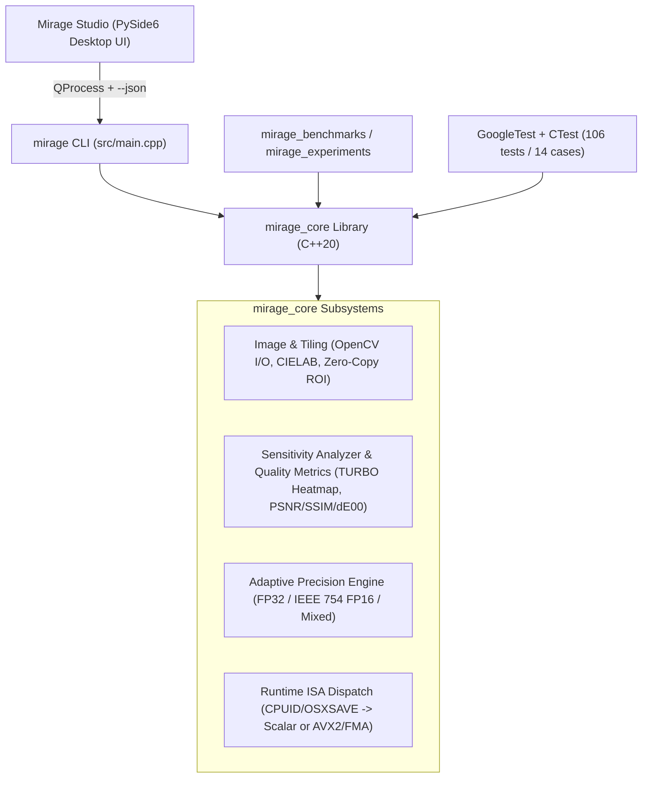

```text
Mirage/
│
├── include/mirage/
│   ├── analysis/        # sensitivity_analyzer.hpp, quality_metrics.hpp
│   ├── core/            # error.hpp, half.hpp
│   ├── cpu/             # cpu_features.hpp
│   ├── enhancement/     # enhancement_engine.hpp, precision_config.hpp
│   ├── image/           # image_loader.hpp, color_converter.hpp, tile_manager.hpp
│   ├── precision/       # adaptive_precision.hpp
│   ├── simd/            # simd_backend.hpp, avx2_kernels.hpp
│   └── version.hpp
│
├── src/
│   ├── main.cpp         # CLI entry point (--enhance, --analyze-sensitivity, --json)
│   ├── analysis/
│   ├── core/
│   ├── cpu/
│   ├── enhancement/
│   ├── image/
│   ├── precision/
│   └── simd/            # Isolated AVX2/FMA kernel compilation unit
│
├── tests/               # 106 GoogleTest unit tests + CTest CLI checks
├── benchmarks/
│   ├── experiments/     # Generated Phase 9 experiment CSVs
│   ├── plots/           # Publication PNG plots rendered via Pycairo
│   ├── results/         # Hardware benchmark CSVs
│   ├── benchmark_runner.cpp
│   ├── experiment_runner.cpp
│   ├── perf_sampler.hpp
│   └── run_experiments.sh
│
├── data/experiments/    # 7-modality synthetic dataset + manifest CSV
├── docs/                # architecture.md, development.md, performance & research reports, images/
├── examples/            # mirage_generate_sample & mirage_generate_dataset
├── scripts/             # mirage_studio.py, analyze_experiments.py, plot_performance.py, tests
├── analysis/
├── CMakeLists.txt
├── CMakePresets.json
├── CHANGELOG.md
├── CONTRIBUTING.md
├── LICENSE
└── mirage-studio        # Desktop Studio launcher
```

---

## 8. Installation

### Requirements

- C++20-compatible compiler (`GCC 11+` or `Clang 14+`)
- `CMake >= 3.20`
- `OpenCV` 4 or 5 (`core`, `imgproc`, `imgcodecs`)
- `Ninja` (recommended)
- `GoogleTest` (`gtest`)
- `Python 3.10+` with `PySide6` (and optional `numpy`, `pandas`, `pycairo` for experiment plots)

### Arch Linux

```bash
sudo pacman -S --needed \
    base-devel \
    cmake \
    ninja \
    opencv \
    gtest
```

### Ubuntu / Debian

```bash
sudo apt update
sudo apt install -y \
    build-essential \
    cmake \
    ninja-build \
    libopencv-dev \
    libgtest-dev
```

Install Python desktop and research dependencies:

```bash
python3 -m pip install PySide6 numpy pandas pycairo
```

---

## 9. Building from Source

Clone the repository and verify your toolchain (optional):

```bash
git clone https://github.com/ankursaini200/Mirage.git
cd Mirage
./scripts/check_env.sh
```

### Release Build (Preset)

```bash
cmake --preset release
cmake --build --preset release --parallel
```

### Debug Build (Preset)

```bash
cmake --preset debug
cmake --build --preset debug --parallel
```

### Standard CMake Build

```bash
cmake -S . -B build/release -DCMAKE_BUILD_TYPE=Release
cmake --build build/release --parallel
```

---

## 10. Usage

The examples below run directly on the tracked dataset image [`data/experiments/natural_scene.png`](data/experiments/natural_scene.png) and save generated outputs to the gitignored `output/` directory.

### Inspect Hardware & Images

```bash
# Display build, compiler, and CPU ISA support (AVX2 / FMA / F16C)
./build/release/mirage --info

# Display image dimensions and format metadata
./build/release/mirage --image-info data/experiments/natural_scene.png

# Inspect spatial tile partitioning (e.g., 32x32 tiles)
./build/release/mirage --tile-info data/experiments/natural_scene.png --tile-size 32

# Generate a custom synthetic sample image if needed
./build/release/mirage_generate_sample output/sample_image.png
```

### Image Enhancement Modes

```bash
mkdir -p output

# Uniform FP32 enhancement with automatic SIMD dispatch
./build/release/mirage \
    --enhance data/experiments/natural_scene.png \
    --output output/enhanced_fp32.png \
    --precision fp32 \
    --brightness 0.1 \
    --contrast 1.2 \
    --saturation 1.3 \
    --gamma 1.0 \
    --backend auto

# Uniform software-emulated FP16 enhancement
./build/release/mirage \
    --enhance data/experiments/natural_scene.png \
    --output output/enhanced_fp16.png \
    --precision fp16

# Mixed precision enhancement
./build/release/mirage \
    --enhance data/experiments/natural_scene.png \
    --output output/enhanced_mixed.png \
    --precision mixed

# Sensitivity-guided adaptive precision with heatmap, precision map, and JSON telemetry
./build/release/mirage \
    --enhance data/experiments/natural_scene.png \
    --output output/enhanced_adaptive.png \
    --precision adaptive \
    --tile-size 32 \
    --sensitivity-threshold 0.04 \
    --backend avx2 \
    --save-heatmap output/heatmap.png \
    --save-precision-map output/precision_map.png \
    --json
```

### Sensitivity Analysis & Tile Visualization

```bash
# Analyze tile sensitivity and export both heatmap PNG and CSV metrics
./build/release/mirage \
    --analyze-sensitivity data/experiments/natural_scene.png \
    --tile-size 32 \
    --output output/sensitivity_heatmap.png \
    --csv output/sensitivity_report.csv
```

### Launch Mirage Dark Creative Studio

```bash
# Launch desktop UI
./mirage-studio

# Or open directly with an image loaded
./mirage-studio data/experiments/natural_scene.png
```

---

## 11. Running Tests

```bash
# Run CTest suite (Release)
ctest --test-dir build/release --output-on-failure

# Run CTest suite (Debug)
ctest --test-dir build/debug --output-on-failure

# Run GoogleTest binary directly (106 tests across 16 suites)
./build/release/tests/mirage_tests

# Run headless Studio UI verification suites
QT_QPA_PLATFORM=offscreen python3 scripts/test_studio_headless.py
QT_QPA_PLATFORM=offscreen python3 scripts/test_experiments_workspace.py
QT_QPA_PLATFORM=offscreen python3 scripts/test_results_view.py
```

Verified configuration: **106 GoogleTest unit tests** across **16 test suites**, **14 CTest cases** (`100%` pass rate), and headless GUI verification suites; [`.github/workflows/ci.yml`](.github/workflows/ci.yml) runs `Debug` and `Release` builds across both GCC and Clang.

---

## 12. Research Dataset & Reproducibility

Mirage includes a curated 7-modality synthetic `512 × 512` evaluation dataset in [`data/experiments/`](data/experiments/dataset_manifest.csv):

| Preview | Modality | Purpose |
| :---: | :--- | :--- |
|  | **Smooth Gradient** (`mod_01`) | False contouring and rounding banding in low-gradient zones |
| 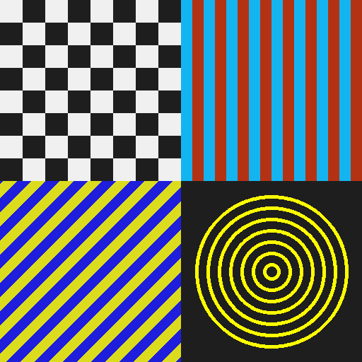 | **High-Contrast Edges** (`mod_02`) | Sharp boundaries, checkerboards, and concentric contours |
| 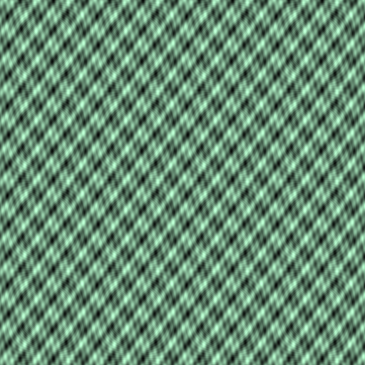 | **Detailed Texture** (`mod_03`) | High-frequency sinusoidal patterns and micro-texture masking |
| 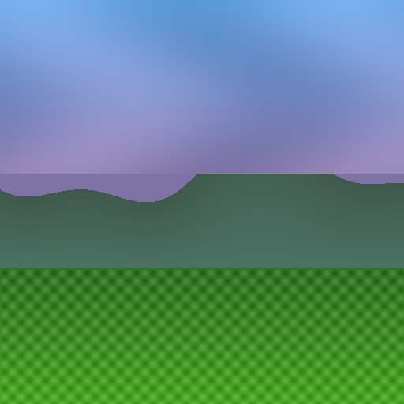 | **Natural Scene** (`mod_04`) | Mixed atmospheric gradients, ridges, and foliage patterns |
| 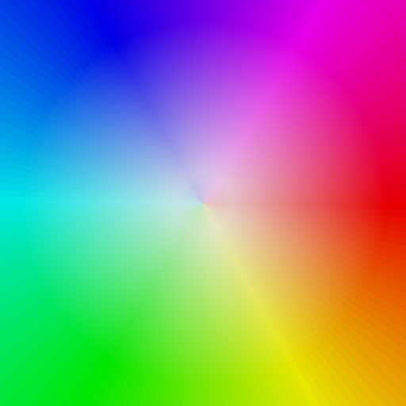 | **Color Rich** (`mod_05`) | Radial gamut testing broad chromatic variation |
|  | **Low Contrast** (`mod_06`) | Narrow luminance dynamic range testing quantization sensitivity |
| 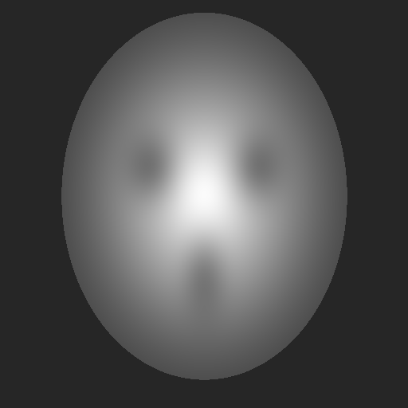 | **Grayscale Portrait** (`mod_07`) | Monochromatic luminance shading and smooth contours |

Regenerate the dataset and reproduce full experiments or hardware microbenchmarks:

```bash
# Regenerate 7-modality dataset
./build/release/mirage_generate_dataset data/experiments

# Run C++ ablation/Pareto experiments + statistical analysis & plots
bash benchmarks/run_experiments.sh

# Run standalone hardware counter microbenchmark suite & performance plots
./build/release/benchmarks/mirage_benchmarks
python3 scripts/plot_performance.py
```

---

## 13. Limitations

Mirage is an experimental research codebase; results should be interpreted within tested configurations:

- FP16 arithmetic is **software-emulated** on CPU rather than executed via native FP16 hardware vectors.
- Sensitivity scoring is a spatial heuristic and does not guarantee human perceptual optimality on unseen photography.
- AVX2 vectorization covers selected FP32 operations (`brightness`, `contrast`, fused `brightness+contrast`, `saturation`); gamma remains scalar to match the FP32 reference.
- On systems without native FP16 vector throughput, software adaptive processing increases cycle count relative to uniform FP32.
- Microbenchmark counters and latencies vary across CPUs, compilers, memory subsystems, and OS security settings (`/proc/sys/kernel/perf_event_paranoid`).

---

## 14. Contributing

Contributions, bug reports, and architecture discussions are welcome! Before contributing:

1. Read [`CONTRIBUTING.md`](CONTRIBUTING.md) and [`CODE_OF_CONDUCT.md`](CODE_OF_CONDUCT.md).
2. Preserve strict separation between the C++20 processing engine and the PySide6 desktop interface.
3. Add GoogleTest or Python headless tests for new features and verify `ctest` passes.
4. Include reproducible hardware/benchmark methodology for any performance claims.

---

## 15. License

Mirage is released under the [MIT License](LICENSE).

---

<p align="center">
  <strong>MIRAGE</strong>
  <br>
  Exploring the relationship between numerical precision, image quality, and computational performance.
  <br><br>
  <a href="https://github.com/ankursaini200/Mirage">GitHub Repository</a> ·
  <a href="docs/architecture.md">Architecture</a> ·
  <a href="docs/performance-analysis.md">Performance Analysis</a> ·
  <a href="docs/research-results.md">Research Results</a>
</p>
